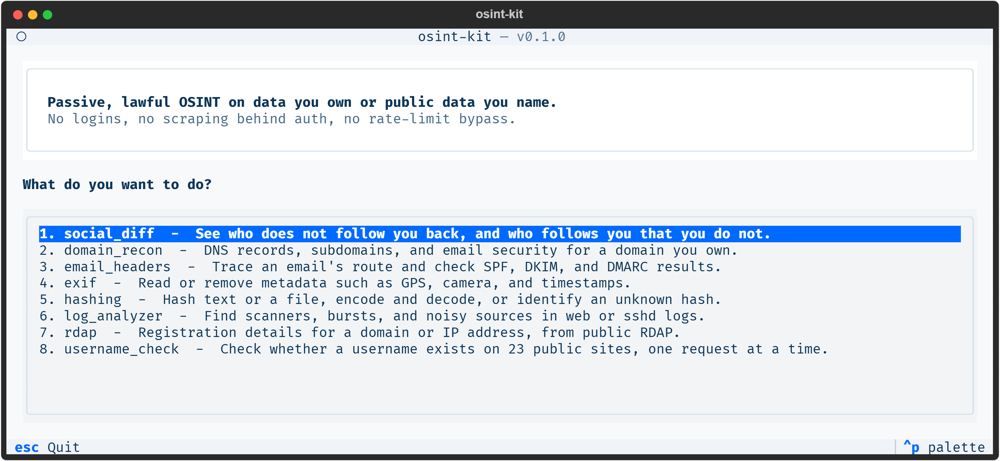
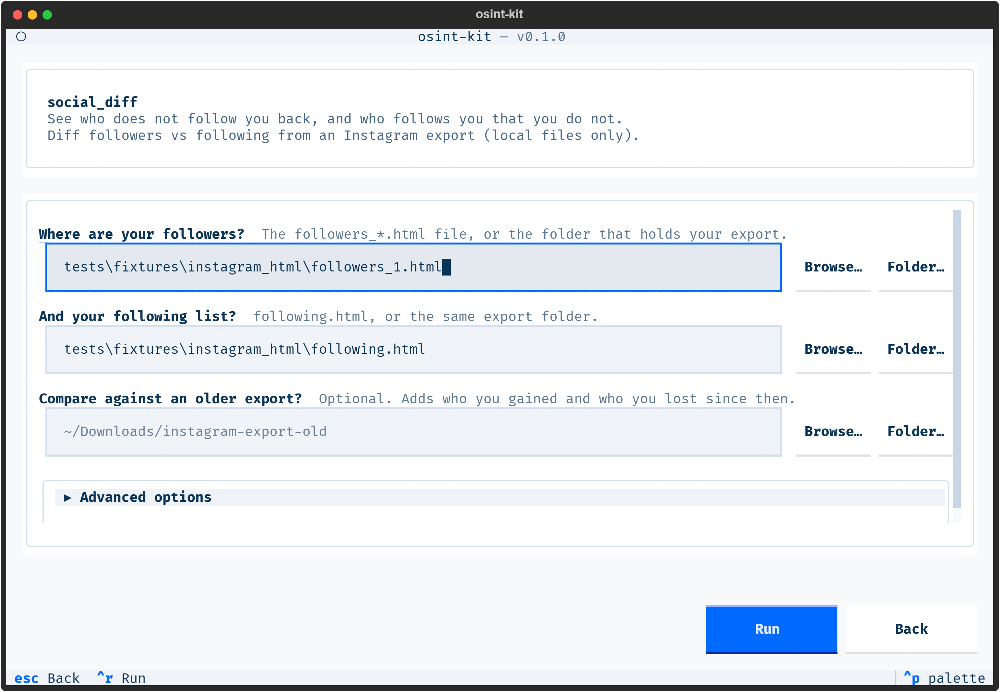
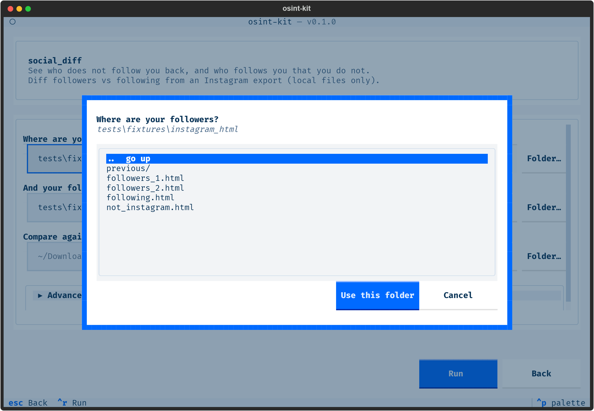
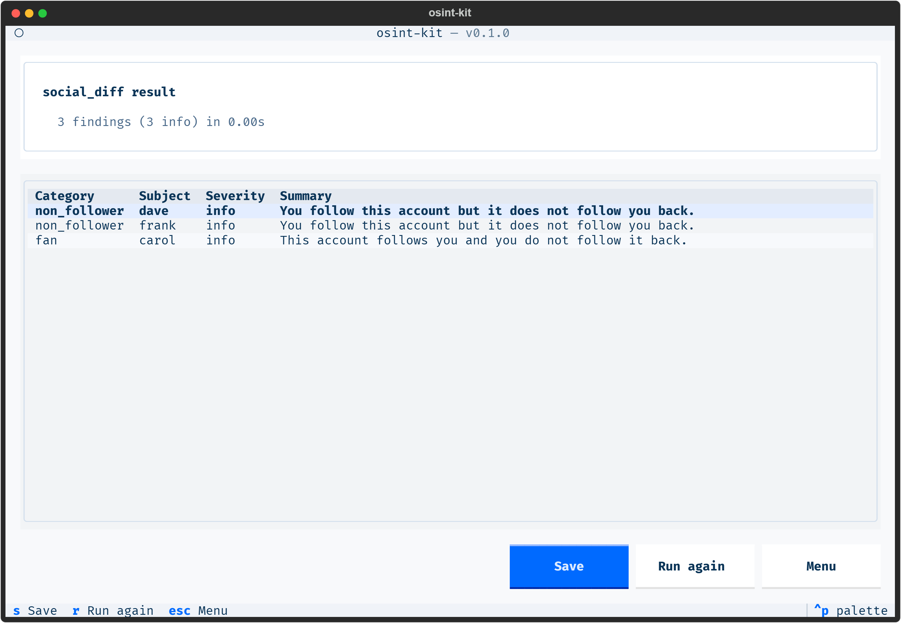
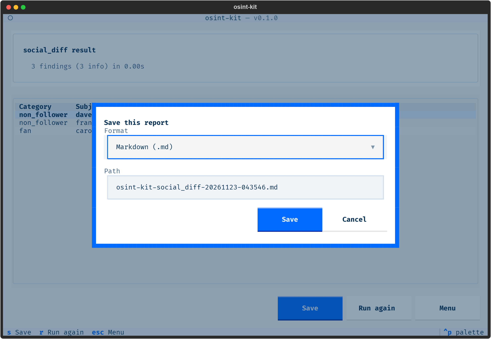
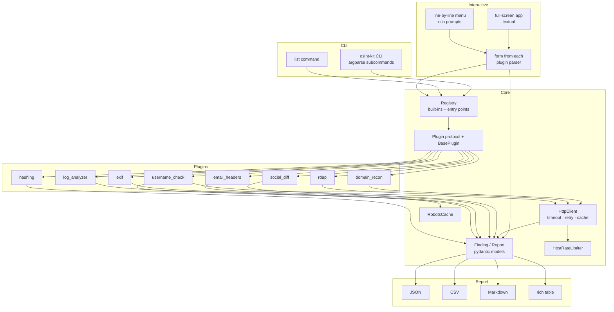

<h1 align="center">osint-kit</h1>

<p align="center">
  <em>Passive, lawful OSINT for data you own.<br>
  It started as a 33-line script that told you who unfollowed you on Instagram.</em>
</p>

<p align="center">
  <a href="https://github.com/developer-az/pyFollowerVsFollowing/actions/workflows/ci.yml"></a>
  
  
  
  
  
</p>

<p align="center">
  
</p>

<p align="center">
  <a href="#quick-start">Quick start</a> ·
  <a href="#screenshots">Screenshots</a> ·
  <a href="#interactive-mode">Interactive mode</a> ·
  <a href="#plugins">Plugins</a> ·
  <a href="#scope-and-ethics">Ethics</a> ·
  <a href="#architecture">Architecture</a> ·
  <a href="#benchmark">Benchmark</a>
</p>

---

## Hi! 👋

This is the project from my [YouTube walkthrough](https://youtu.be/ZugkbNARgnU).
It began as 33 lines: read two Instagram export files, print the handles that
don't follow you back. It worked, but it did one thing, in one way, and only if
you remembered the file names.

`osint-kit` is that idea grown up — eight tools, four output formats, and an app
you can drive without memorising a single flag. The promise is the same as day
one: **it reads the data you gave it, and nothing else.**

```bash
osint-kit                                   # asks, then runs
osint-kit social_diff --followers ... --following ...   # or skip the questions
```

No flags, no arguments, no memorised paths. It asks what you want to do, builds
a form from the plugin you picked, runs it, and shows a table you can save —
while the same plugin stays reachable from a script with the flags below.

### What's inside

| | |
| --- | --- |
| **Diff your followers** | Who doesn't follow you back, who you don't follow back, and what changed since last month — from *your* Instagram export. |
| **Check a domain** | DNS, certificate-transparency subdomains, SPF/DMARC, DNSSEC, and registration data. |
| **Read the metadata** | EXIF from your own photos (and strip it), mail headers, and web/ssh logs. |
| **Check a handle** | Does `octocat` exist on 23 public sites? One request per site, robots-aware, no login anywhere. |
| **Hash and encode** | SHA-2, BLAKE2, base64/hex, and hash identification. |

Python 3.11+. Standard library first: the only runtime dependencies are `httpx`,
`pydantic`, and `rich`; `textual` is optional and only needed for the full-screen
app.

---

## Quick start

```bash
git clone https://github.com/developer-az/pyFollowerVsFollowing.git
cd pyFollowerVsFollowing
python -m venv .venv
source .venv/bin/activate           # Windows: .venv\Scripts\activate
pip install -e ".[dev,tui]"         # tools + full-screen app
```

Then run it with no arguments:

```bash
osint-kit                           # the app in the screenshot above
osint-kit list                      # what is installed, and what uses the network
```

The console script is `osint-kit`; `python -m osint_kit` is equivalent.

**The original use case.** Request your Instagram data export (HTML or JSON),
extract it, and point the tool at it — the app offers the files it finds in the
current folder, `Downloads`, or `Desktop`:

```bash
osint-kit social_diff \
  --followers path/to/followers_1.html path/to/followers_2.html \
  --following path/to/following.html \
  --format table
```

```
                             osint-kit - social_diff
+--------------+--------------------------------+----------+------------------------------------------+
| Category     | Subject                        | Severity | Summary                                  |
|--------------+--------------------------------+----------+------------------------------------------|
| non_follower | accountthatdoesntfollowyouback | info     | You follow this account but it does not  |
|              |                                |          | follow you back.                         |
| fan          | accountthatfollowsyouback2     | info     | This account follows you and you do not  |
|              |                                |          | follow it back.                          |
+--------------+--------------------------------+----------+------------------------------------------+
```

The legacy entry point still works for the original tutorial. It reads
`followers_1.html` and `following.html` from the current directory:

```bash
python followerfollowing.py
```

> **Never commit a real export.** `.gitignore` blocks `followers*.html`,
> `following.html`, `followers*.json`, and `following.json` outside the synthetic
> test fixtures. If you ever committed one, purge it from history — see
> [Privacy](#privacy).

---

## Screenshots

The full-screen app, `textual` + `rich`, on a 120×40 terminal. Arrow keys or
number keys move; the footer always shows the keys that work where you are.

| Fill in the form | Pick a file |
| :---: | :---: |
|  |  |
| Every question comes from the plugin's own argument parser. | **Browse…** opens the system dialog, or this list when tkinter is missing. |

| Read the result | Save it |
| :---: | :---: |
|  |  |
| Findings, severity, and how long it took. | Markdown, JSON, or CSV — with a timestamped name suggested. |

These are generated from the real app, not mock-ups:

```bash
python docs/screenshots/capture.py        # needs Chrome, Edge, or Chromium
```

---

## Interactive mode

Two surfaces over the same session, because not every machine has a terminal
that can draw a box.

### Full-screen app

With `textual` installed (`pip install "osint-kit[tui]"`) and a real terminal,
`osint-kit` opens the app. The form is real widgets: text inputs, dropdowns for
fixed choices, checkboxes for flags, and an **Advanced options** panel that stays
collapsed until you want it. Results land in a table you can scroll, and the
footer always shows the keys that work on the current screen.

Every question that reads from disk has a **Browse…** button, so you never have
to type a path. On Windows it opens the normal file dialog — with a **Folder…**
button where a directory is also a valid answer, as with an Instagram export. On
any other machine, or if tkinter is missing, it opens a small list you drive with
the arrow keys and `enter`. Browsing starts beside whatever the field already
points at.

| Key | Screen | Action |
| --- | --- | --- |
| `1`–`8` / arrows / `enter` | plugin list | open a plugin |
| `ctrl+r` | form | run it |
| `esc` | form | back to the list |
| `s` | results | save (Markdown, JSON, or CSV) |
| `r` | results | fill the form again |
| `esc` | results | back to the list |
| `ctrl+p` | anywhere | command palette |

Save opens a small dialog: pick the format, the suggested filename updates its
extension, edit the path if you want, confirm.

### Line-by-line menu

When `textual` is not installed, stdin is not a terminal, or you pass `--plain`,
the same session runs as prompts:

```bash
osint-kit tui --plain
```

```
What do you want to do?
  1. social_diff - start here. See who does not follow you back, and...
  ...
> 1

+-------------------------------- plugin -----------------------------+
| social_diff                                                         |
+---------------------------------------------------------------------+
Where are your followers?
The followers_*.html file, or the folder that holds your export.
> C:\Users\you\Downloads\instagram-export

And your following list?
following.html, or the same export folder.
> C:\Users\you\Downloads\instagram-export\following.html

Compare against an older export?
Optional. Adds who you gained and who you lost since then.
>                                      (Enter to skip)

Change any advanced options?
> n
```

Both surfaces work the same way, and both feed the CLI:

- **Finds your export.** If `followers_*.html` and `following.*` are in the
  current folder, `Downloads`, or `Desktop`, it offers them instead of making
  you type a path.
- **Asks before touching the network.** Network plugins make you confirm the
  read-only requests first, and `--offline` refuses to run them at all.
- **Keeps the sharp edges out of the way.** Thresholds, log formats, and limits
  live behind one "advanced options" step; the defaults are the ones the CLI
  uses.
- **Saves when you want it.** Markdown, JSON, or CSV, with a timestamped
  filename suggested.

The questions are generated from each plugin's own argument parser, so every
plugin has a form, including ones you write yourself. Neither front end is a
second implementation: both fill the same options the CLI fills and call the
same `plugin.run`, so anything you can do interactively you can also script with
the flags below.

---

## Scope and ethics

This project is **passive and lawful by design**. Read this before running a
network plugin.

- **Analyse only data you own, or public data you are authorised to examine.**
  The follower tools run entirely on *your* Instagram data export. Nothing is
  fetched from Instagram.
- **No authentication is attempted.** No logins, no session cookies, no
  scraping behind a login wall, no API keys borrowed from an app.
- **No rate-limit or anti-bot bypass.** Requests go only to public,
  unauthenticated endpoints. A per-host token bucket is always on; the default
  is one request per second per host.
- **robots.txt is respected** for the multi-host plugin (`username_check`).
  A disallowed path is skipped and reported, not fetched.
- **No bulk profiling of private people.** `username_check` answers "does this
  handle exist on this public site?" for a single handle. It deliberately does
  not cross-link identities, scrape followers of strangers, or build dossiers.
- **You are responsible for the law where you live** (GDPR, CFAA, computer
  misuse acts, platform terms). If an analysis would harm someone, don't run it.
- Network plugins print a one-line notice the first time they run in a process.

If you need to investigate a person, get consent or a lawful basis first. This
tool is for self-audits, incident response on your own logs and mail, and
checking your own domain's hygiene.

**Where other tools stop.** Instagram and TikTok are deliberately absent from
`username_check`. Both answer HTTP 200 with a login wall for handles that do not
exist, so a status-code check there would be fiction; making it work means a
session cookie, which is the one thing this project does not do. The lawful path
to Instagram data is your own export — `social_diff` — and that is the whole
tool.

---

## Plugins

| Plugin | Data source | Network? | Privacy behaviour |
| --- | --- | --- | --- |
| `social_diff` | Your Instagram export (HTML/JSON) | No | Local files only; nothing is uploaded. Handles pagination and duplicates. |
| `domain_recon` | Google DoH, crt.sh | Yes | Queries only the domain you name; no zone transfer, no brute force. Public endpoints only. |
| `rdap` | rdap.org, Team Cymru DoH | Yes | Registration data for one domain/IP; no WHOIS scraping behind a form. |
| `email_headers` | Raw headers you supply | No | Local parsing; body is ignored. Use on your own mail or with consent. |
| `exif` | Local image bytes | No | Local read; `--strip` writes a sanitised copy. GPS is flagged as medium severity. |
| `log_analyzer` | Local access/auth logs | No | Streams your logs; no external lookups, no IP enrichment. |
| `hashing` | Strings/files you supply | No | Local only. |
| `username_check` | 23 public profile URLs | Yes | Allowlisted hosts only, robots.txt respected, 1 req/s per host, one handle. Hosts that block the client are reported as one line, never as "available". |

Output formats: `--format json|csv|md|table` (default `table`), plus
`--output FILE` to write to disk. JSON is the stable machine format; CSV has
one row per finding with details JSON-encoded in one cell.

Global options on every plugin command: `--offline`, `--no-cache`,
`--cache-dir`, `--timeout`, `--retries`, `--rate-limit`.

Exit codes: `0` success, `2` usage/input/network error, `1` unexpected crash,
`130` interrupted.

### `social_diff`

Reads your export and reports three kinds of edge:

- `non_follower` — you follow them, they don't follow you.
- `fan` — they follow you, you don't follow back.
- `mutual` — both (use `--include-mutuals`).
- `--previous OLD_EXPORT` — compare snapshots and emit `new_follower` /
  `lost_follower`.

### `domain_recon`

```bash
osint-kit domain_recon example.com --format md
```

Queries Google's DoH endpoint for A/AAAA/MX/NS/TXT/DS/DNSKEY, pulls subdomains
from certificate transparency (crt.sh), and flags missing/weak SPF, missing
DMARC, `p=none`, and absent DNSSEC.

### `rdap`

```bash
osint-kit rdap 8.8.8.8 --format json
osint-kit rdap example.com --format table
```

RDAP gives the netblock, registration events, registrar, nameservers, and
domain statuses. For IPs the ASN is enriched through Team Cymru's public DNS
service over DoH.

### `email_headers`

```bash
osint-kit email_headers message.eml --format md
cat message.eml | osint-kit email_headers - --format json
```

Outputs the hop chain with timestamps and per-hop latency, SPF/DKIM/DMARC
verdicts, From-vs-Return-Path mismatch, chain breaks, and suspicious Received
ordering.

### `exif`

```bash
osint-kit exif photo.jpg
osint-kit exif --strip photo.jpg --dest clean.jpg
```

Reads GPS, device, lens, serial, and timestamp tags from JPEG and PNG without
third-party libraries. `--strip` writes a copy with EXIF/XMP/IPTC/comment
metadata removed, keeping JFIF and colour-profile chunks.

### `log_analyzer`

```bash
osint-kit log_analyzer access.log --format table
osint-kit log_analyzer /var/log/auth.log --log-format sshd --window 60
```

Streams the file line by line: top sources, failed-login bursts in a sliding
window, scanner user agents, sensitive-path scanning, and attempted usernames.
Combined web logs and sshd auth logs are auto-detected.

### `hashing`

```bash
osint-kit hashing --text "hello" --algorithm sha256 --algorithm blake2b
osint-kit hashing --file ./sample.bin --format json
osint-kit hashing --identify 5f4dcc3b5aa765d61d8327deb882cf99
osint-kit hashing --text "hello" --encode base64
osint-kit hashing --text "aGVsbG8=" --decode base64
```

### `username_check`

```bash
osint-kit username_check octocat --format table
osint-kit username_check octocat --site github --site codeberg
```

Twenty-three allowlisted public profile pages, one handle at a time. robots.txt
is checked per host and obeying it is the default. A 200 response is a *hint*,
not proof of ownership — verify manually.

Sites that refuse a non-browser client (403/406/429 and friends) are not treated
as "free": they are collapsed into one warning line naming the hosts, because a
blocked request says nothing either way.

---

## Architecture



Design rules:

- **Pure functions in the middle, I/O at the edges.** Parsers take text or
  bytes. The plugin's `run()` is the only place that touches the filesystem,
  network, or stdin.
- **Typed end to end.** `mypy --strict` covers `src/`, `tests/`, and
  `benchmarks/`.
- **One report shape.** Every plugin returns `Report` with `Finding` rows, so
  all four renderers work for every plugin.

---

## Plugin authoring guide

A plugin is any object satisfying `osint_kit.core.plugin.Plugin`:

```python
class Plugin(Protocol):
    @property
    def name(self) -> str: ...
    @property
    def summary(self) -> str: ...
    @property
    def network(self) -> bool: ...
    def configure_parser(self, parser: argparse.ArgumentParser) -> None: ...
    def run(self, options: argparse.Namespace, ctx: PluginContext) -> Report: ...
```

In practice, subclass `BasePlugin` and set three class attributes:

```python
# src/osint_kit/plugins/example.py
from __future__ import annotations

import argparse

from osint_kit.core.models import Report, Severity
from osint_kit.core.plugin import BasePlugin, PluginContext


def count_words(text: str) -> dict[str, int]:
    """Pure, typed, no I/O — this is the part to unit-test."""
    words = text.casefold().split()
    return {"words": len(words), "unique": len(set(words))}


class ExamplePlugin(BasePlugin):
    NAME = "example"
    SUMMARY = "Count words in a text file."
    NETWORK = False

    def configure_parser(self, parser: argparse.ArgumentParser) -> None:
        parser.add_argument("file", type=argparse.FileType("r", encoding="utf-8"))

    def run(self, options: argparse.Namespace, ctx: PluginContext) -> Report:
        text = options.file.read()  # I/O at the edge
        stats = count_words(text)  # pure core
        report = Report(plugin=self.name, target=options.file.name)
        report.stats.update(stats)
        report.add(
            category="text",
            subject=options.file.name,
            summary=f"{stats['unique']} unique words.",
            severity=Severity.INFO,
        )
        return report
```

Register it two ways:

1. **In-tree:** add the class to `builtin_plugin_types()` in
   `core/registry.py`.
2. **Third-party:** publish a package with an entry point:

```toml
[project.entry-points."osint_kit.plugins"]
example = "my_package.example:ExamplePlugin"
```

Rules of the road:

- Keep analysis functions pure and typed; do file/network I/O only in
  `configure_parser`/`run`.
- Use `ctx.http()` for network access — you inherit the timeout, retries,
  cache, per-host rate limit, and the passive-use notice.
- Use `ctx.robots()` before fetching third-party pages.
- Return findings; never print. The CLI owns formatting and exit codes.
- Raise `osint_kit.core.errors.OsintKitError` subclasses for user-facing errors.
- Add tests with synthetic fixtures and, for parsers, at least one Hypothesis
  property.

The interactive modes need nothing from you: both read `configure_parser` and
build a form from the arguments you declared. If a question reads badly, add
wording in `tui/copy.py` (a label, a hint, or `primary=True` to move an optional
argument out of "advanced"); there is no second place to keep the inputs in
sync.

---

## Development

```bash
ruff check .
ruff format --check .
mypy                    # strict; config in pyproject.toml
pytest --cov=osint_kit --cov-report=term-missing --cov-fail-under=80
```

CI runs the same commands on Python 3.11 and 3.12.

### Tests and fixtures

`tests/fixtures/` contains only synthetic data: placeholder Instagram pages,
JSON exports, mail headers, logs, DNS/RDAP payloads, and a generated JPEG/PNG
with fake EXIF (camera "TestCam", a public San Francisco coordinate). Regenerate
the images with:

```bash
python tests/fixtures/images/build_samples.py
```

Property tests use Hypothesis for the HTML/JSON parsers, log line parser,
encoding round-trips, and set algebra.

### Benchmark

The original algorithm was `[u for u in following if u not in followers]` with a
list, i.e. O(n·m). `social_diff` uses sets, O(n + m):

```bash
python benchmarks/bench_social_diff.py --size 100000
```

Measured on this machine (Windows 11, Python 3.12, disjoint 100k × 100k):

| Implementation | Time | Result |
| --- | ---: | --- |
| Original list scan (`in` on a list) | 58.508 s | 100,000 non-followers |
| `social_diff` set comparison | 0.089 s | identical |
| **Speedup** | **654×** | |

Raw output: `benchmarks/results.json`. Re-run with
`python benchmarks/bench_social_diff.py --size 100000`.

`tests/test_benchmark.py` runs the same comparison at 3k in CI and asserts the
set implementation is both identical in output and at least 2× faster.

---

## Privacy

- Personal exports are git-ignored and were removed from the tree. The two
  export files that were committed early in this repository's history contained
  only placeholder handles (`accountthatfollowsyouback`, `randomaccount`, ...),
  so no history rewrite was needed for them.
- If a real export was ever committed under a different name, purge it before
  publishing:

```bash
pip install git-filter-repo
git filter-repo --path followers_1.html --path following.html --invert-paths
git push --force-with-lease
```

Then rotate anything sensitive that the files contained (they are usually just
public handles, but check).

- Network plugins keep a response cache under the per-user cache directory
  (`%LOCALAPPDATA%\osint-kit\cache` on Windows,
  `$XDG_CACHE_HOME/osint-kit` elsewhere). Disable with `--no-cache`; clear by
  deleting the directory.

---

## Limitations

- Instagram export formats change. The parser handles the HTML pages and the
  `string_list_data` JSON shape; unknown shapes fail with a clear error instead
  of silently returning nothing.
- `username_check` is heuristic and some sites block non-browser clients or
  serve 200 for missing users. Unknowns are reported as `unknown`, blocked hosts
  as one `blocked` warning, never as "available". Instagram and TikTok are
  deliberately absent: both answer 200 with a login wall for handles that do not
  exist, so a status-code check there would be fiction.
- EXIF support covers JPEG and PNG, common IFD0/Exif/GPS tags, and both TIFF
  byte orders. BigTIFF, HEIC, and maker notes are out of scope.
- DNSSEC is inferred from DS/DNSKEY presence and the DoH AD bit, not from a
  local validating resolver.
- RDAP and crt.sh are third-party services and can be slow or unavailable; the
  report notes the failure rather than failing the whole run.

---

## License

MIT — see [LICENSE](LICENSE).

Not affiliated with Instagram, Google, crt.sh, Team Cymru, or any site listed in
`username_check`. Use responsibly and lawfully.
